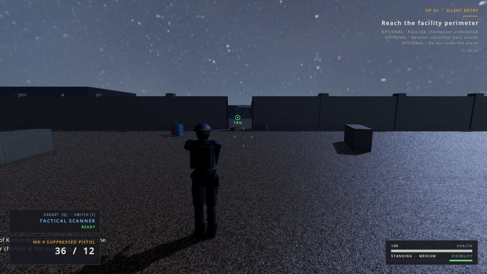
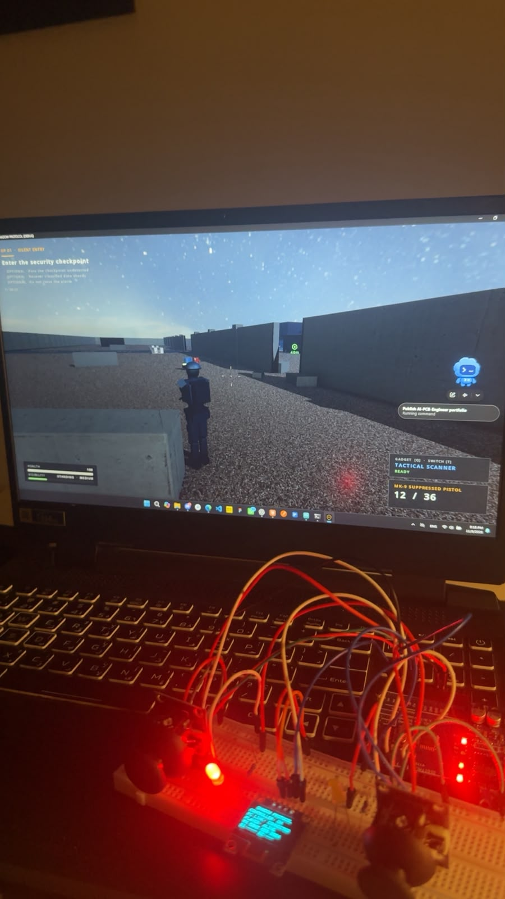
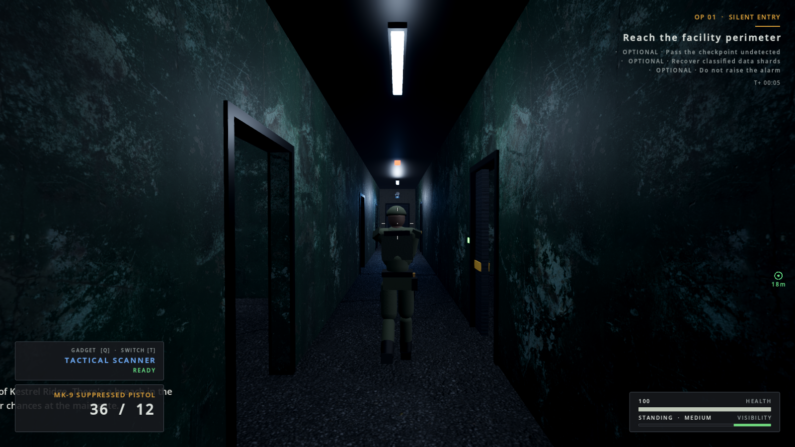
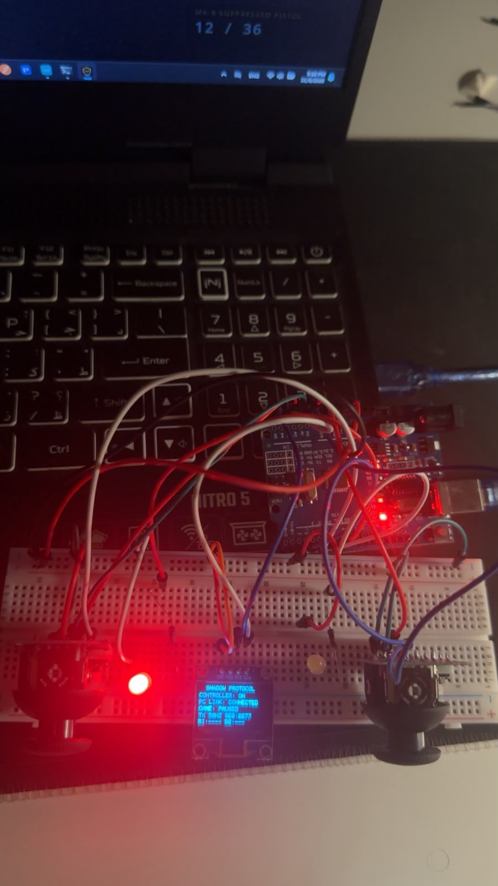

# SHADOW PROTOCOL

SHADOW PROTOCOL is a third-person tactical stealth game built with Godot 4.7.2 and GDScript. Its three-mission campaign combines stealth, enemy perception and AI, weapon and gadget systems, mission objectives, and an optional Arduino Uno dual-joystick controller.

## Screenshots

The gameplay images were captured from the running Godot project. The hardware images show the controller prototype during gameplay.

| Gameplay | Controller prototype |
| --- | --- |
|  |  |
|  |  |

## Features

- Three connected missions: **Silent Entry**, **Black Signal**, and **Final Extraction**.
- Third-person movement, stealth visibility and sound systems, enemy perception and state-driven AI, security systems, weapons, gadgets, objectives, checkpoints, and campaign saves.
- Keyboard and mouse, standard gamepad, or the optional SHADOW CONTROLLER V2.
- Arduino firmware and a Python serial-to-UDP bridge with an OLED game-status display and LED indicators.

See [the architecture overview](docs/ARCHITECTURE.md) and [controller integration guide](ARDUINO_INTEGRATION.md) for implementation details.

## Requirements

- Windows 11 (the game project and launch scripts target Windows).
- Godot **4.7.2 Standard** for running the source project; add the Godot executable to `PATH` as `godot`.
- Python **3.10 or newer** and `pyserial` for the hardware bridge. The bridge launcher installs `pyserial` if it is missing.
- Arduino Uno and the listed components only when using the physical controller.

## Run the game

1. Install Godot 4.7.2 Standard and make its executable available as `godot` on `PATH`.
2. Clone or download this repository and open its folder.
3. Double-click **`Play SHADOW PROTOCOL.bat`**, or run `godot --path .` from the project folder.

The game can be played without the Arduino controller. Keyboard, mouse, and gamepad input remain available. The packaged Windows executable and `.pck` are build outputs and are not included in this source repository; use the Godot project to run or export the game.

## Run with the SHADOW CONTROLLER V2

1. Install the firmware from `controller_firmware/ShadowController_V2_Link/ShadowController_V2_Link.ino` using Arduino IDE and the required Adafruit SSD1306 and GFX libraries.
2. Connect the controller over USB.
3. Close Arduino IDE's Serial Monitor so the Python bridge can own the COM port.
4. Double-click **`Play with Shadow Controller.bat`**. It starts the bridge and then launches the game.

The bridge auto-detects supported USB serial devices. See [ARDUINO_INTEGRATION.md](ARDUINO_INTEGRATION.md) for wiring, firmware setup, serial protocol, and troubleshooting.

## Controls

| Input | Action |
| --- | --- |
| WASD | Move |
| Mouse | Camera look |
| Right mouse button | Aim |
| Left mouse button | Fire |
| Shift / Alt / C | Sprint / walk / crouch |
| R / E | Reload / interact (hold E for terminal interactions) |
| Q / T | Use gadget / cycle gadget |
| 1 / 2 / 3 | Select weapon |
| V / Tab / Esc | Swap shoulder / objectives / pause |
| Controller J1 stick / press | Look and aim / fire |
| Controller J2 stick / press | Move and strafe / interact (hold to hack) |

Controls can be remapped in **Settings → Controls**. Standard gamepads are supported.

## Architecture and communication

The game routes native and external input through a shared input layer. The optional bridge reads controller frames over USB serial at 115200 baud and exchanges controller input and game state with Godot over localhost UDP. Firmware owns stick sampling and status indicators; game logic remains in Godot. The OLED reports link and player state.

```text
Dual joysticks + buttons → Arduino Uno → USB serial → Python bridge
                                                        ↕ UDP / localhost
Keyboard / mouse / gamepad ───────────────────────→ Godot input router → game
Arduino Uno ← USB serial ← Python bridge ← game state (health / status)
```

The exact message formats, ports, and disconnect behavior are documented in [ARDUINO_INTEGRATION.md](ARDUINO_INTEGRATION.md).

## Testing and validation

The latest checked-in Godot test report records **60 passed and 0 failed**; it is the existing project report, not a run performed as part of publication. Coverage includes input, saves, health, settings, AI, security, player and weapon systems, gadgets, controller integration, and mission walkthroughs.

Commands and the stored report are described in [docs/TESTING.md](docs/TESTING.md). Human playtesting of feel and difficulty is still outstanding.

## Asset credits and licensing

- Poly Haven models and textures are CC0; individual asset names, authors, and source pages are listed in [docs/ASSETS_AND_CREDITS.md](docs/ASSETS_AND_CREDITS.md).
- Sound effects, ambience, and music are generated by the project's procedural audio script.
- The generated Windows SAPI voice WAV files are omitted from the public snapshot because redistribution terms for these outputs have not been established. The game falls back to subtitles when a voice clip is missing. Local regeneration instructions are in the credits document.
- Adafruit SSD1306 and GFX are external Arduino dependencies; they are installed separately and are not copied into this repository.
- Godot Engine is MIT-licensed. This repository does not currently assign a separate license to the SHADOW PROTOCOL project code.

## Known limitations

- The exported single-file executable could not be produced because Godot export templates were not installed in the source environment.
- Character and weapon visuals use procedural primitive rigs and code-generated animations.
- Human playtesting of gameplay feel and difficulty has not been completed.

## Project layout

| Path | Contents |
| --- | --- |
| `scenes/`, `scripts/`, `resources/` | Godot scenes, gameplay code, and data resources |
| `assets/` | Game textures, models, and generated sound assets |
| `controller_firmware/` | Current controller firmware, original backup, and firmware tests |
| `controller_bridge/` | Python serial bridge, protocol, and tests |
| `tests/` | Godot unit and integration tests |
| `docs/`, `ARDUINO_INTEGRATION.md` | Test report, architecture, setup, credits, and controller documentation |
